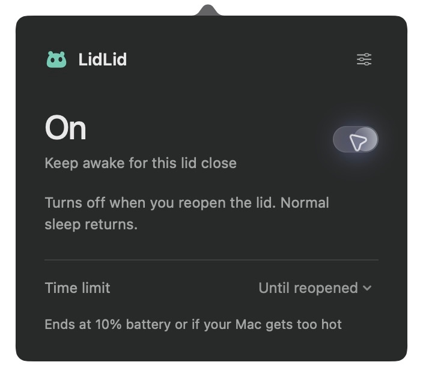

<p align="center">
  
</p>

<h1 align="center">Lidune · 合留</h1>

<p align="center"><strong>Close the lid. Carry on.</strong><br>Take your laptop with you. Keep your local work going.</p>

<p align="center">
  <a href="README.zh-CN.md">简体中文</a> ·
  <a href="https://github.com/kf953741/lidune/releases/download/v1.1.1-preview.1/Lidune-1.1.1-macOS-arm64.dmg">Download DMG · Apple Silicon</a> ·
  <a href="https://github.com/kf953741/lidune/issues/new?template=compatibility.yml">Report your setup</a> ·
  <a href="LICENSE">MIT license</a>
</p>


## Your task isn't done. You need to go.

Codex or Claude Code is still working **on your Mac**, a build is underway, or a download hasn't finished. You need to head out or move to another room. To keep the Mac awake, you end up balancing an open laptop in both hands while you walk.

Lidune is built around that moment: turn on closed-lid keep-awake for **this session**, close the lid, and take the laptop with you. Reopening ends the session and returns sleep control to macOS.


*Illustrated on-the-go workflow. Lidune targets the Mac doing local work; cloud-hosted jobs can run independently.*

## Why Lidune

| Feature | What it means |
| --- | --- |
| **One-shot by design** | Turn it on for the next lid close. Reopening ends that session. Every app launch starts off. |
| **One switch** | Two normal states: off and on. A matching owl symbol lives in the menu bar. |
| **No administrator setup** | Uses an unprivileged IOKit call and power assertions. No sudo rule, root helper, driver, or kernel extension. |
| **An optional time limit** | Choose 30 minutes, 1, 2, 4, or 8 hours. Reopening the lid still ends the session sooner. |
| **Automatic stop conditions** | Ends on battery power at 10%, serious/critical thermal pressure, missing sensor readings, or an attached external display. |
| **Recovery paths** | A separate session process handles UI exit or a missing heartbeat; a live UI can clean up after the session process exits. [Limits](docs/ARCHITECTURE.md#recovery-limits) apply. |
| **English and 简体中文** | Follows your system language. Switch languages instantly in Options → Language. |
| **Local and native** | Swift, SwiftUI, AppKit, and IOKit. No third-party runtime packages, account, analytics, or network service. |

## A small interface

<p align="center">
  
  
</p>

*Actual English interface. Prefer Chinese? Select **Options → Language → 简体中文**.*


## Install and use

**Target:** an Apple Silicon (M-series) MacBook running macOS 14 or later, with no external display connected. **Intel MacBooks are not currently supported.** See [compatibility notes](docs/VALIDATION.md).

1. Download the [Apple Silicon DMG](https://github.com/kf953741/lidune/releases/download/v1.1.1-preview.1/Lidune-1.1.1-macOS-arm64.dmg).
2. Open the DMG, drag `Lidune.app` to **Applications**, then open Lidune from Applications. This build is **ad-hoc signed, not notarized**. If macOS blocks the first launch, review it through System Settings → Privacy & Security. No security-disabling shell command is needed.
3. Click the owl in your menu bar. Turn on the switch until the interface shows **On**.
4. Close the lid for this session. Reopen it to end the session automatically. You can also switch it off manually.

A [ZIP archive](https://github.com/kf953741/lidune/releases/download/v1.1.1-preview.1/Lidune-v1.1.1-preview.1-macOS-arm64.zip) is also available. Checksums are included on the [release page](https://github.com/kf953741/lidune/releases/tag/v1.1.1-preview.1).

<details>
<summary>See the DMG installer</summary>
<p align="center"></p>
</details>

The **Time limit** is measured from activation. The interface follows your system language by default; choose **Options → Language → English / 简体中文** to override it. Login launch is optional and off by default. Right-clicking the menu-bar icon also toggles the session.

Keep ventilation unobstructed while carrying your Mac. End the session before putting it in a bag or sleeve. Network-dependent tasks still need a working connection. Do not run multiple lid-sleep controllers together; Lidune blocks activation while Clamshell is running. An external display ends the Lidune session and returns control to macOS.

<details>
<summary>Options and protection settings</summary>

<p align="center"></p>

</details>

## Help us find the useful version of this idea

This project is open-source so we can learn which local workflows you need to take with you.

- **Use Codex or Claude Code locally?** Tell us what you need to keep running and for how long.
- **Tried a real close/open cycle?** [Report your model, macOS version, power source, and result](https://github.com/kf953741/lidune/issues/new?template=compatibility.yml). Also check whether the following lid close sleeps normally.
- **Need something different?** [Describe the workflow](https://github.com/kf953741/lidune/issues/new?template=feature_request.yml).

If you want to follow the project, a star helps others discover it. Compatibility reports and specific use cases help us decide what to build next.

## Build from source

Requires a macOS 14+ SDK and Swift 5.9 or newer, provided by Xcode or compatible Command Line Tools. The current download was built with Swift 6.4.2.

```sh
git clone https://github.com/kf953741/lidune.git
cd lidune
swift test
zsh scripts/build.sh
zsh scripts/package-dmg.sh
open dist/Lidune.app
```

The build script creates an ad-hoc-signed app. Automated tests cover the one-shot state machine and language selection, messages, and duration formatting.

The DMG step uses Python 3 and downloads the pinned `dmgbuild` packaging tool into an isolated build environment. It creates a drag-to-install image with an Applications shortcut and verifies the image. This is a build dependency; the app has no Python runtime dependency. Packaging settings follow the [dmgbuild documentation](https://dmgbuild.readthedocs.io/en/latest/settings.html).

Read [Architecture](docs/ARCHITECTURE.md), [Validation](docs/VALIDATION.md), and [Contributing](CONTRIBUTING.md) for the implementation, known limitations, and manual checks. `LidOnce` remains the internal executable/module name for compatibility.

## License and artwork

[MIT](LICENSE), © 2026 Fei Kang. UI and menu-bar artwork are original. The app icon and campaign illustrations were generated for this project; their provenance is in [Assets](docs/ASSETS.md).

The implementation references Apple's published [IOPMLibDefs.h](https://github.com/apple-oss-distributions/xnu/blob/main/iokit/IOKit/pwr_mgt/IOPMLibDefs.h), [RootDomainUserClient.cpp](https://github.com/apple-oss-distributions/xnu/blob/main/iokit/Kernel/RootDomainUserClient.cpp), and [IOPMrootDomain.cpp](https://github.com/apple-oss-distributions/xnu/blob/main/iokit/Kernel/IOPMrootDomain.cpp). The initial API investigation included a locally installed Clamshell app; this repository includes no Clamshell code, binaries, artwork, or licensing logic.
