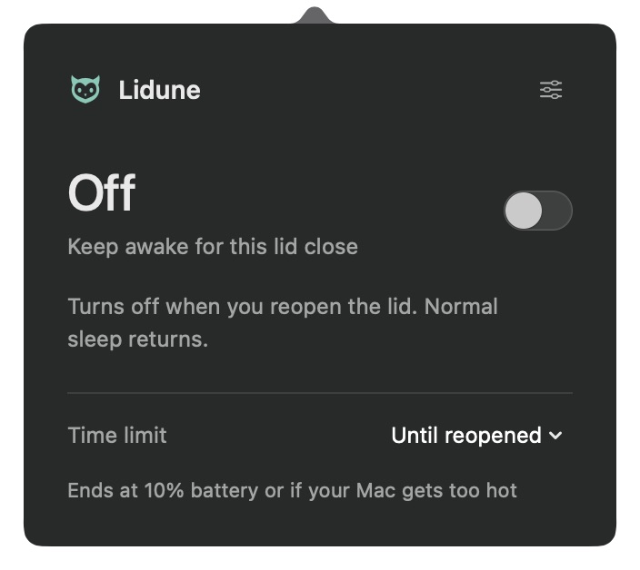
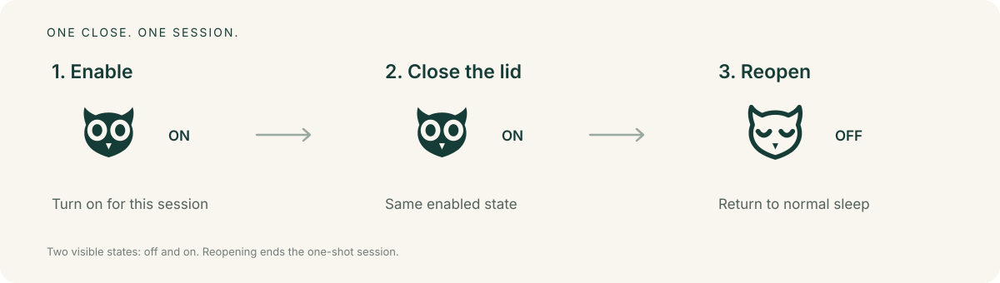

<h1 align="center">LidLid · 盖盖 Keep your MacBook awake with the lid closed</h1>

<strong>Close the lid. Carry on.</strong>

  <a href="https://lidlid.bigsmart.cc/en/support/#app-store">Get LidLid</a> ·
  <a href="https://lidlid.bigsmart.cc/en/">Website</a> ·
  <a href="https://lidlid.bigsmart.cc/en/support/">Getting started</a> ·
  <a href="README.zh-CN.md">简体中文 · MacBook 合盖不休眠</a>

**Keep Codex and Claude Code running with your MacBook lid closed.** LidLid is an open-source menu bar app that keeps local tasks, builds and downloads running while you carry your Mac. Switch it on before closing the lid; reopening ends the session automatically.

Watch the 20-second demo

*Actual app interface with illustrated on-the-go scenes.*

## Why LidLid

- **One switch:** turn it on from the menu bar, with an optional time limit.
- **Ends when you reopen:** switch it on again next time you need it.
- **No external monitor:** works on battery; stops automatically if the battery is low or your Mac gets too hot.
- **Easy to use:** English and Chinese, native light & dark UI, no app account, and always-free open-lid and display keep-awake modes.

## Keep Codex and Claude Code running when you close your MacBook

  
  

Menu-bar icons and workflow

## Install and use

For **Apple Silicon (M-series) MacBooks on macOS 14 or later**, without an external display connected. Intel Macs are not currently supported.

The Mac App Store version is being prepared for launch. Its link will appear on the [website](https://lidlid.bigsmart.cc/en/support/#app-store). Open-lid mode is always free. Try closed-lid mode free for 7 days, then unlock it for life for US$4.99 (¥38 in mainland China). No subscription or automatic renewal.

1. Install and open LidLid.
2. For closed-lid mode, choose **Set up closed-lid mode** in LidLid. Download the DMG, drag the component into **Applications**, open it and approve its service in macOS. LidLid detects readiness automatically.
3. Claim the trial or unlock lifetime access, start your local task and turn on closed-lid mode. Wait for **Ready to close**, close the lid and go. Reopening ends the session automatically.

For open-lid keep-awake or timed/continuous **Keep display awake** (30 min, 1 hour, or until off), just turn on the free switches—no component needed. Trial expiry never interrupts a session already in progress.

[Setup guide](https://lidlid.bigsmart.cc/en/support/) · [Free compatibility component DMG](https://lidlid.bigsmart.cc/downloads/LidLid-Compatibility-1.0.1-macOS-arm64.dmg) (requires the LidLid main app).

Online tasks still need a connection.

---

Questions or feedback? Email [lidlid@bigsmart.cc](mailto:lidlid@bigsmart.cc). If LidLid helps you, give it a Star.

[MIT license](LICENSE)
