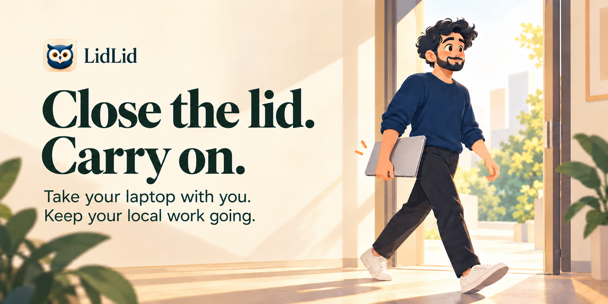

<h1 align="center">LidLid · 盖盖 Keep your MacBook awake with the lid closed</h1>

<strong>Close the lid. Carry on.</strong>

  <a href="https://lidlid.bigsmart.cc/en/">Official Website</a> ·
  <a href="https://lidlid.bigsmart.cc/en/support/">Setup & Support</a> ·
  <a href="https://github.com/kf953741/lidlid-compatibility">Open-Source Helper (MIT)</a> ·
  <a href="README.zh-CN.md">简体中文</a>

**Keep local Codex, Claude Code, builds, and downloads running when you close your MacBook.** Turn LidLid on from your menu bar before closing the lid—no external monitor or power cable required. When you reopen your MacBook, the session ends automatically and normal lid sleep is restored.

---

## Interface (Dark & Light)

  
  

## Highlights

- **One-shot closed-lid session:** Enable for this lid close; reopening restores normal macOS sleep automatically.
- **No external monitor needed:** Works on battery on **Apple Silicon & Intel MacBooks** (macOS 14+), with automatic low-battery (10%), thermal, and optional time-limit cutoffs.
- **Always-free open-lid & display keep-awake:** Built-in **Open-lid awake** and **Keep display awake** (30 min, 1 hour, or until off) are permanently free—no companion component needed, and also work on desktop Macs.
- **Private & local-only:** Zero accounts, zero analytics, zero telemetry. LidLid never reads your code, files, or AI chats.
- **Auditable privileged helper (MIT):** The separately installed compatibility component that manages `SleepDisabled` is **100% open-source** at [kf953741/lidlid-compatibility](https://github.com/kf953741/lidlid-compatibility).

## Pricing & Distribution

| Feature | Availability |
| --- | --- |
| **Open-lid keep-awake** | Always free |
| **Keep display awake** (30m / 1h / Until off) | Always free |
| **Closed-lid keep-awake** (MacBook, requires free component) | **7-day free trial** (no auto-renewal), then **one-time purchase** (US$4.99 / ¥38 mainland China) |

- **Main App (Mac App Store):** Being prepared for release — status & download link at [lidlid.bigsmart.cc/en/support/#app-store](https://lidlid.bigsmart.cc/en/support/#app-store).
- **Free Compatibility Component:** Signed with Developer ID, notarized by Apple, and open-source MIT at [kf953741/lidlid-compatibility](https://github.com/kf953741/lidlid-compatibility).

## Repository Structure

This repository is the **public showcase, changelog, and community feedback hub** for LidLid:

- **Security-critical privileged helper (Public · MIT):** [kf953741/lidlid-compatibility](https://github.com/kf953741/lidlid-compatibility)
- **Commercial Mac App Store main app:** Maintained in a private repository (`v1.6.1+`). Earlier commits remain available in git history under their original MIT license (see [NOTICE.md](NOTICE.md)).

## Support & Feedback

- Setup guide & FAQ: [https://lidlid.bigsmart.cc/en/support/](https://lidlid.bigsmart.cc/en/support/)
- Privacy policy: [https://lidlid.bigsmart.cc/en/privacy/](https://lidlid.bigsmart.cc/en/privacy/)
- Direct email: [lidlid@bigsmart.cc](mailto:lidlid@bigsmart.cc)
- Bug reports & feature ideas: [GitHub Issues](https://github.com/kf953741/lidlid/issues)

If LidLid saves you from babysitting long tasks, give this repo a Star!
