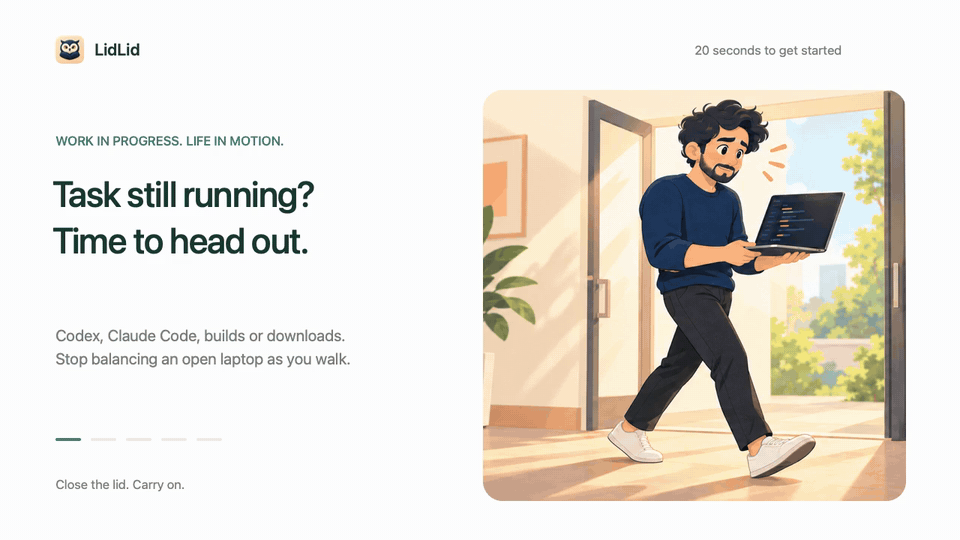
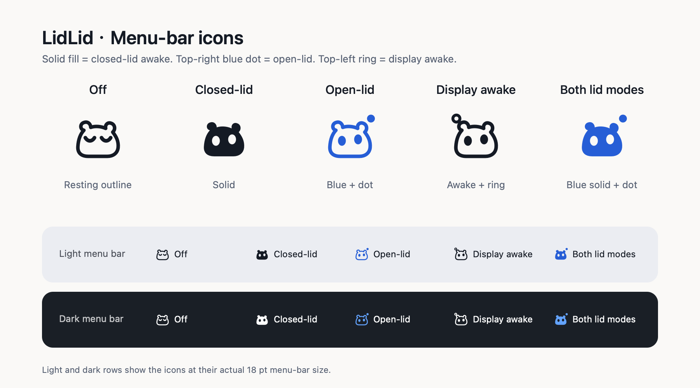

<h1 align="center">LidLid · 盖盖 Keep your MacBook awake with the lid closed</h1>

<strong>Close the lid. Carry on.</strong>

  <a href="https://github.com/kf953741/lidlid/releases/download/v1.2.0/LidLid-1.2.0-macOS-arm64.dmg">Download LidLid DMG</a> ·
  <a href="https://lidlid.vercel.app/en/">Website</a> ·
  <a href="docs/USAGE.md">Getting started</a> ·
  <a href="README.zh-CN.md">简体中文 · MacBook 合盖不休眠</a>

**Keep Codex and Claude Code running with your MacBook lid closed.** LidLid is a free, open-source menu bar app that keeps local tasks, builds and downloads running while you carry your Mac. Switch it on before closing the lid; reopening ends the session automatically.

Watch the 20-second demo

*Actual app interface with illustrated on-the-go scenes.*

## Why LidLid

- **One switch:** turn it on from the menu bar, with an optional time limit.
- **Ends when you reopen:** switch it on again next time you need it.
- **No external monitor:** works on battery; stops automatically if the battery is low or your Mac gets too hot.
- **Easy to use:** English and Chinese, free and open source, no account needed.

## Keep Codex and Claude Code running when you close your MacBook

  
  

Menu-bar icons and workflow

## Install and use

For **Apple Silicon (M-series) MacBooks on macOS 14 or later**, without an external display connected. Intel Macs are not currently supported.

1. [Download the DMG](https://github.com/kf953741/lidlid/releases/download/v1.2.0/LidLid-1.2.0-macOS-arm64.dmg), drag LidLid into **Applications**, then launch it.
2. Click the owl in your menu bar, turn on the switch and wait for **On**.
3. Close the lid and take your Mac with you. Reopening ends the session; you can also switch it off manually.

For first-launch help and language settings, see the [two-minute setup guide](docs/USAGE.md).

Keep your Mac ventilated. End the session before putting it in a bag or sleeve. Online tasks still need a connection.

---

Questions or feedback? Email [kf953741@gmail.com](mailto:kf953741@gmail.com). If LidLid helps you, give it a Star.

[MIT license](LICENSE)
