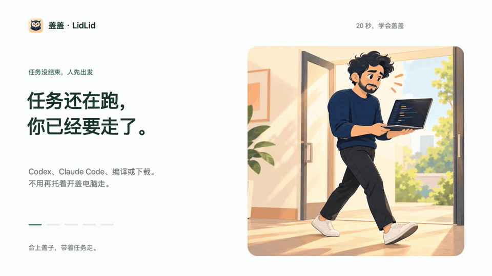
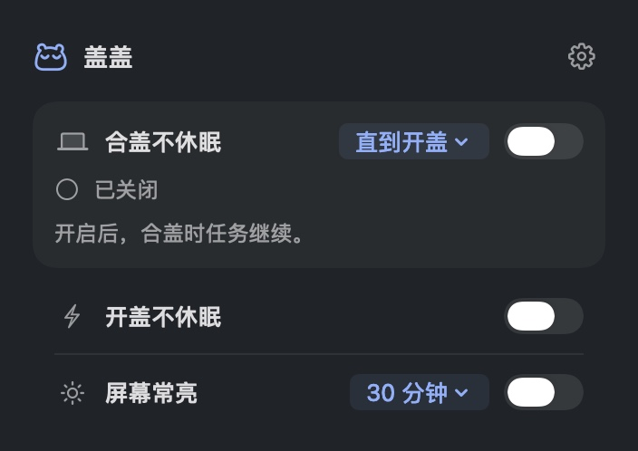
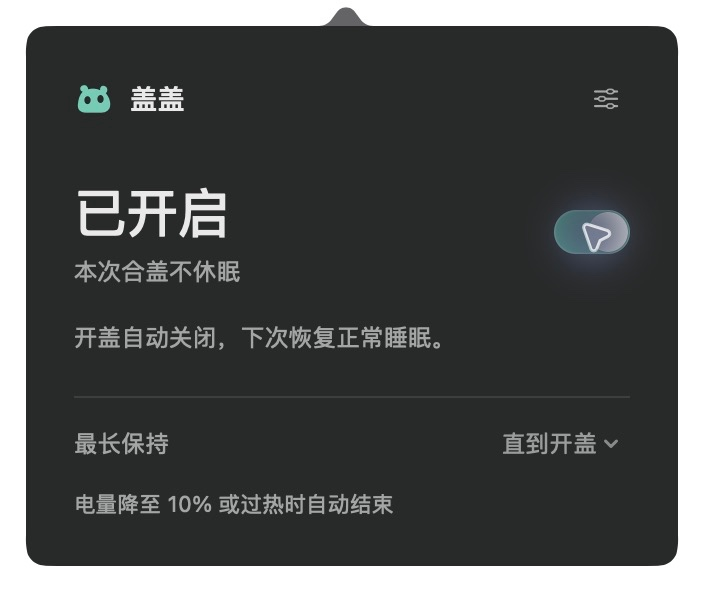
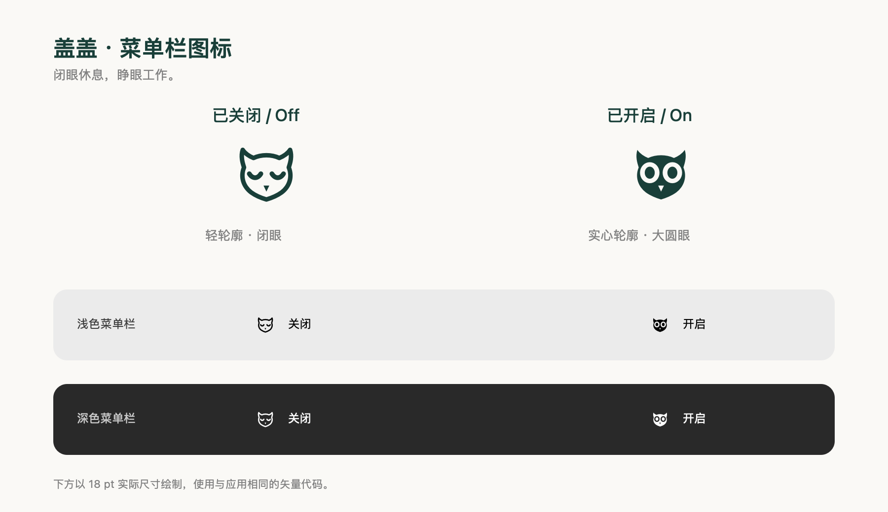
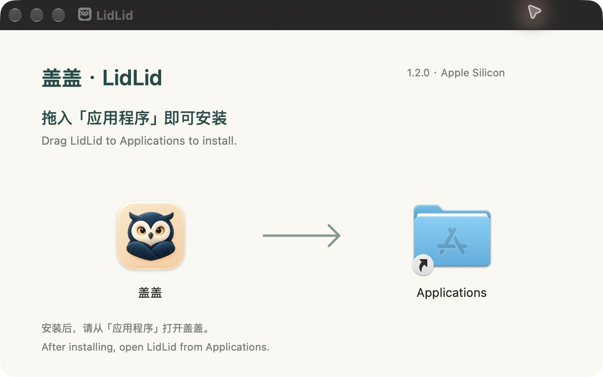

<p align="center"></p>

<h1 align="center">盖盖 · LidLid<br>MacBook 合盖不休眠</h1>

<p align="center"><strong>合上盖子，带着任务走。</strong><br>任务还没跑完，也能合盖出发。</p>

<p align="center">
  <a href="README.md">English</a> ·
  <a href="https://github.com/kf953741/lidlid/releases/download/v1.2.0/LidLid-1.2.0-macOS-arm64.dmg">下载 DMG（M 系列）</a> ·
  <a href="https://github.com/kf953741/lidlid/issues/new?template=compatibility.yml">反馈兼容性</a> ·
  <a href="LICENSE">MIT 开源协议</a>
</p>

**盖盖（LidLid）是一款免费开源的 MacBook 合盖不休眠菜单栏工具，无需外接显示器。** 让 Mac 本机的 Codex、Claude Code、编译和下载在合盖后继续运行，需要出门或换个地方时，可以合上盖子带着电脑走。开启一次，再次开盖自动结束。适用于 Apple Silicon（M 系列）MacBook，要求 macOS 14+。



[下载 20 秒视频（MP4）](https://github.com/kf953741/lidlid/raw/refs/heads/main/docs/assets/zh-CN/usage-demo.mp4) · [两分钟上手教程](docs/USAGE.zh-CN.md)

*真实应用界面，搭配移动办公场景插画。*

## Codex、Claude Code 还没跑完，也能合盖出发

Codex、Claude Code 正在**你的 Mac 本机**执行任务，编译或下载也还没结束。可你已经要出门，或是换个地方继续工作。为了不让电脑睡眠，只能双手托着开盖的笔记本，一路小心地走。

盖盖为这个时刻而做：开启**本次合盖不休眠**，合上盖子，把电脑一起带走。再次开盖，本次自动结束，恢复正常睡眠。


*移动办公场景示意。盖盖面向需要保持 Mac 本机运行的工作，云端任务可能独立运行。*

## 优势

| 特点 | 使用体验 |
| --- | --- |
| **只用一次** | 对下一次合盖生效，开盖自动结束；每次重新启动软件默认关闭。 |
| **一个开关** | 正常只有开启、关闭两种状态，菜单栏用睁眼／闭眼猫头鹰区分。 |
| **无需管理员配置** | 使用普通用户 IOKit 调用和电源请求，不安装 root helper、sudoers 规则或驱动。 |
| **可设最长时长** | 支持 30 分钟、1／2／4／8 小时；提前开盖仍会结束。 |
| **自动结束条件** | 电池供电降至 10%、严重高温、关键读数中断或接入外接屏时结束本次。 |
| **有恢复路径** | 界面退出或心跳中断时由会话进程清理；会话进程退出时由仍存活的界面清理。[存在边界](docs/ARCHITECTURE.md#recovery-limits)。 |
| **中英文界面** | 默认跟随系统，可在「选项 → 语言」即时切换简体中文或 English。 |
| **原生、本地、开源** | Swift／SwiftUI／AppKit／IOKit，无第三方运行包、账号、分析统计或网络服务。 |

## 简约界面

<p align="center">
  
  
</p>

*真实中文界面；可在「选项 → 语言」切换为 English。*

<details>
<summary>查看菜单栏的开启与关闭图标</summary>
<p align="center"></p>
</details>


## 安装与使用

**目标环境：** Apple Silicon（M 系列）MacBook、macOS 14 或更新版本，不连接外接显示器。**目前不支持 Intel MacBook。** 详见[兼容性说明](docs/VALIDATION.md)。

1. 下载 [M 系列 DMG 安装包](https://github.com/kf953741/lidlid/releases/download/v1.2.0/LidLid-1.2.0-macOS-arm64.dmg)。
2. 打开 DMG，将 `LidLid.app`（盖盖）拖入「**应用程序**」，再从「应用程序」打开。当前为**本地临时签名，尚未经过 Apple 公证**。若首次启动被拦截，请通过「系统设置 → 隐私与安全性」检查和确认；不需要执行关闭系统安全功能的命令。
3. 点击菜单栏猫头鹰，打开开关，确认显示「**已开启**」。
4. 本次合盖保持唤醒；重新开盖会自动结束。也可以随时手动关闭开关。

<details>
<summary>查看 DMG 安装界面</summary>
<p align="center"></p>
</details>

界面默认跟随系统语言，也可以在「选项 → 语言」选择「简体中文」或「English」，即时生效。最长保持时间从按下开关起计算。「登录时启动」默认关闭，可在选项页开启；右键菜单栏图标也能快速切换。

移动时保持散热口无遮挡，装包或放入保护套前先结束本次。联网任务仍需要可用的网络连接。避免同时运行多个合盖控制工具；检测到 Clamshell 正在运行时，LidLid 会阻止开启。接入外接屏会结束本次，交回 macOS 管理。

<details>
<summary>查看选项页</summary>
<p align="center"></p>
</details>

## 常见问题

### MacBook 怎么设置合盖不休眠，不接外接显示器也可以吗？

[下载并安装盖盖 DMG](#安装与使用)，点击菜单栏猫头鹰，打开开关，显示「**已开启**」后再合盖。盖盖面向不连接外接屏的 M 系列 MacBook Air／MacBook Pro；也支持电池供电，电池供电时电量降至 10%、出现严重高温或再次开盖时会结束本次。

### 合上 MacBook 后，Codex 和 Claude Code 还能继续运行吗？

盖盖让 Mac 在本次合盖期间保持唤醒，运行在 **Mac 本机**的任务就能继续执行。任务仍需要其所需的网络连接和用户授权。已经在远程服务器或云端运行的任务，不需要靠盖盖维持远端机器运行。

### 为什么开了 caffeinate，MacBook 合盖后还是会休眠？

阻止空闲休眠与阻止合盖休眠是不同的请求。Apple 的 [`caffeinate`](https://github.com/apple-oss-distributions/PowerManagement/blob/main/caffeinate/caffeinate.c) 使用电源断言；仅防止空闲休眠，并不等于能合盖运行。盖盖还会发起专门的合盖控制请求，详见[电源实现](docs/ARCHITECTURE.md#power-requests)。

### 盖盖会自动识别 Codex／Claude Code 的任务完成吗？

不会。你手动开启本次会话，再次开盖、手动关闭、达到所设时长或触发结束条件时停止。盖盖不读取 AI 对话，也不自动判断任务是否完成。

### MacBook 合盖后可以继续下载、保持 SSH 连接吗？

保持 Mac 唤醒可以让下载、编译和本机 SSH 客户端继续运行。盖盖不提供网络，也不负责重连 Wi-Fi、VPN 或 SSH；移动过程中切换网络仍可能导致连接中断。

### Intel MacBook 可以用吗？

当前 DMG 仅包含 **arm64** 版本，面向 Apple Silicon（M 系列）MacBook、macOS 14 或更新版本；目前不支持 Intel Mac。详见[兼容性说明](docs/VALIDATION.md)。

## 先开源，听听真正的使用需求

我们先把项目开源，想了解：你最需要带着继续运行的本机任务是什么。

- 正在用本机 Codex／Claude Code？告诉我们需要继续运行什么任务、一般多久。
- 做过一次真实合盖／开盖？[提交机型、系统、电源条件和结果](https://github.com/kf953741/lidlid/issues/new?template=compatibility.yml)，也请检查下一次合盖是否恢复正常睡眠。
- 有不同的需求？[描述你的使用场景](https://github.com/kf953741/lidlid/issues/new?template=feature_request.yml)。

想关注后续可以点一个 Star；具体场景和兼容性反馈会帮助我们决定下一步做什么。

## 从源码构建

需要 Xcode 或兼容的 Command Line Tools，包含 macOS 14+ SDK、Swift 5.9 或更新版本。当前安装包使用 Swift 6.4.2 构建。

```sh
git clone https://github.com/kf953741/lidlid.git
cd lidlid
swift test
zsh scripts/build.sh
zsh scripts/package-dmg.sh
open dist/LidLid.app
```

构建脚本生成临时签名应用。自动测试覆盖单次状态逻辑、语言选择、状态消息和时长格式。技术细节见[架构说明](docs/ARCHITECTURE.md)、[验证记录](docs/VALIDATION.md)和[贡献说明](CONTRIBUTING.md)。内部 Swift 模块、设置标识和支持目录保留旧标识，以延续现有偏好设置。

DMG 打包步骤需要 Python 3，会在独立构建环境中下载固定版本的 `dmgbuild`，生成带「应用程序」快捷方式的拖动安装镜像，并校验镜像。这仅是打包依赖，应用运行不需要 Python。配置参考 [dmgbuild 官方文档](https://dmgbuild.readthedocs.io/en/latest/settings.html)。

## 协议与素材

[MIT](LICENSE)，© 2026 Fei Kang。界面与菜单栏图形为独立实现；应用图标和宣传插画由图像生成工具制作，来源见[素材说明](docs/ASSETS.md)。

系统接口参考 Apple 的公开源码。最初的接口调研还包括本机安装的 Clamshell 应用；本仓库不包含其代码、二进制、图形资源或授权逻辑。
