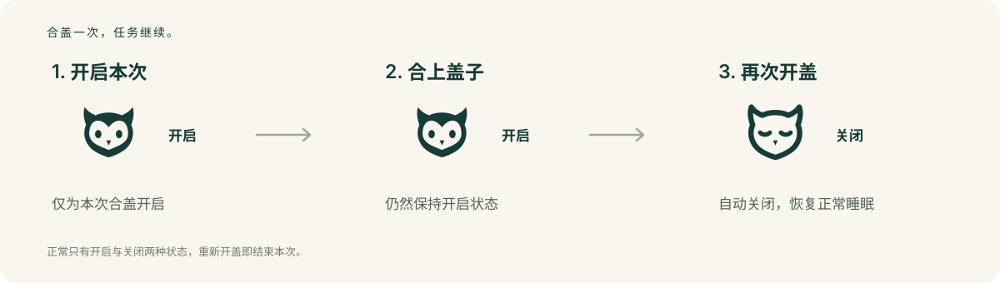

<h1 align="center">盖盖 · LidLid MacBook 合盖不休眠</h1>

<strong>合上盖子，带着任务走。</strong>

  <a href="https://github.com/kf953741/lidlid/releases/download/v1.2.0/LidLid-1.2.0-macOS-arm64.dmg">下载盖盖 DMG</a> ·
  <a href="docs/USAGE.zh-CN.md">上手教程</a> ·
  <a href="README.md">English</a>

**盖盖是一款免费的 MacBook 合盖不休眠工具，让本机 Codex、Claude Code 在合盖后继续运行。** 编译或下载还没结束，你已经要出发。打开开关，合上电脑、从容带走；再次开盖，本次自动结束。

看 20 秒使用演示

*真实应用界面，搭配移动办公场景插画。*

## 为什么用盖盖

- **一个开关**：菜单栏一键开启，还能设置最长保持时间。
- **开盖自动结束**：下次需要时，再开启一次。
- **无需外接屏**：电池供电也能用，低电量或高温时自动结束本次。
- **简单自在**：中英文界面，免费开源，无需账号。

## Codex、Claude Code 合盖继续运行

  
  

查看菜单栏图标与使用流程

## 安装与使用

适用于 **M 系列 MacBook、macOS 14 或更新版本**，不连接外接屏。目前不支持 Intel Mac。

1. [下载 DMG](https://github.com/kf953741/lidlid/releases/download/v1.2.0/LidLid-1.2.0-macOS-arm64.dmg)，打开后将「盖盖」拖入「应用程序」，再打开它。
2. 点击菜单栏猫头鹰，打开开关，确认显示「**已开启**」。
3. 合盖带走，开盖自动结束。也可以随时手动关闭开关。

首次打开被 macOS 拦截、切换语言等操作，见[两分钟上手教程](docs/USAGE.zh-CN.md)。

移动时保持通风，放入包或保护套前先结束本次。联网任务仍需网络连接。

---

欢迎[反馈问题或建议](https://github.com/kf953741/lidlid/issues)。喜欢盖盖，欢迎点一个 Star。

[MIT 开源协议](LICENSE)
