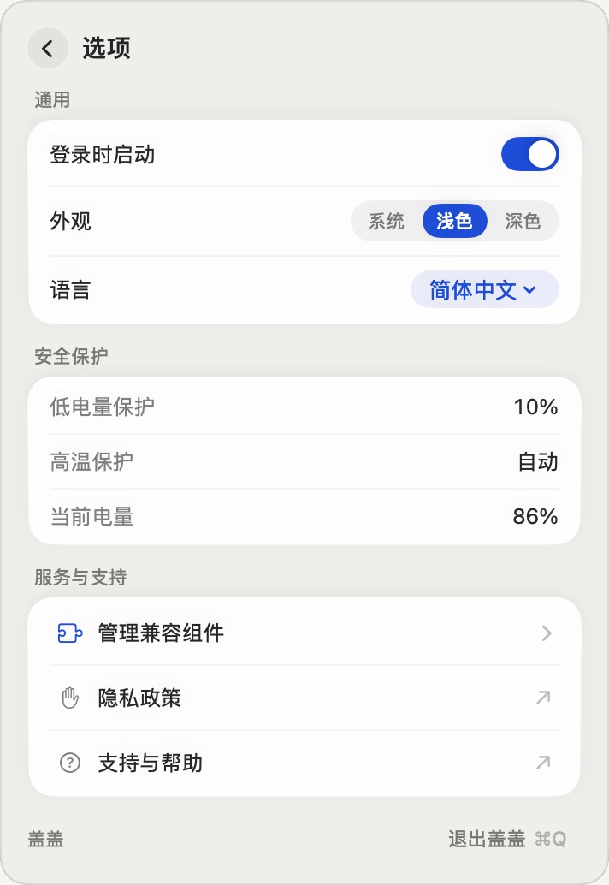

<p align="center"></p>

<h1 align="center">Lidune · 合留</h1>

<p align="center"><strong>合盖一次，任务继续。</strong><br>开启本次合盖不休眠，开盖后自动恢复正常睡眠。</p>

<p align="center">
  <a href="README.md">English</a> ·
  <a href="https://github.com/kf953741/lidune/releases/tag/v1.1.1-preview.1">下载预览版</a> ·
  <a href="https://github.com/kf953741/lidune/issues/new?template=compatibility.yml">反馈兼容性</a> ·
  <a href="LICENSE">MIT 开源协议</a>
</p>


## Agent 还在工作，你却得把电脑一直摊着

Codex、Claude Code 正在**你的 Mac 本机**执行任务，或者编译、下载、终端程序还没结束。你想起身，却只能抱着开盖的电脑，怕它一合盖就睡眠。

Lidune 为这个小场景而做：点一次，只让**本次合盖**保持唤醒；再次开盖，本次自动结束，把正常睡眠交回 macOS。


*本地工作场景示意。云端任务可能独立运行，Lidune 面向需要保持 Mac 本机运行的工作。*

## 优势

| 特点 | 使用体验 |
| --- | --- |
| **只用一次** | 对下一次合盖生效，开盖自动结束；每次重新启动软件默认关闭。 |
| **一个开关** | 正常只有开启、关闭两种状态，菜单栏用睁眼／闭眼猫头鹰区分。 |
| **无需管理员配置** | 使用普通用户 IOKit 调用和电源请求，不安装 root helper、sudoers 规则或驱动。 |
| **可设最长时长** | 支持 30 分钟、1／2／4／8 小时；提前开盖仍会结束。 |
| **自动结束条件** | 电池供电降至 10%、严重高温、关键读数中断或接入外接屏时结束本次。 |
| **有恢复路径** | 界面退出或心跳中断时由会话进程清理；会话进程退出时由仍存活的界面清理。[存在边界](docs/ARCHITECTURE.md#recovery-limits)。 |
| **中英文界面** | 默认跟随系统，可在「选项 → 语言」即时切换简体中文或 English。 |
| **原生、本地、开源** | Swift／SwiftUI／AppKit／IOKit，无第三方运行包、账号、分析统计或网络服务。 |

## 简约界面

<p align="center">
  
  
</p>

*真实中文界面；可在「选项 → 语言」切换为 English。*


## 安装与使用

**目标环境：** Apple Silicon MacBook、macOS 14 或更新版本，不连接外接显示器。详见[兼容性说明](docs/VALIDATION.md)。

1. 从 [Release](https://github.com/kf953741/lidune/releases/tag/v1.1.1-preview.1) 下载 Apple Silicon 安装包。
2. 解压，将 `Lidune.app` 放入「应用程序」并打开。当前为**本地临时签名，尚未经过 Apple 公证**。若首次启动被拦截，请通过「系统设置 → 隐私与安全性」检查和确认；不需要执行关闭系统安全功能的命令。
3. 点击菜单栏猫头鹰，打开开关，确认显示「**已开启**」。
4. 本次合盖保持唤醒；重新开盖会自动结束。也可以随时手动关闭开关。

界面默认跟随系统语言，也可以在「选项 → 语言」选择「简体中文」或「English」，即时生效。最长保持时间从按下开关起计算。「登录时启动」默认关闭，可在选项页开启；右键菜单栏图标也能快速切换。

请在通风桌面使用，装包或放入保护套前先结束本次。避免同时运行多个合盖控制工具；检测到 Clamshell 正在运行时，Lidune 会阻止开启。接入外接屏会结束本次，交回 macOS 管理。

<details>
<summary>查看选项页</summary>
<p align="center"></p>
</details>

## 先开源，听听真正的使用需求

这个公开预览版用来验证：这样一个小工具，是否能解决你的日常麻烦。

- 正在用本机 Codex／Claude Code？告诉我们需要继续运行什么任务、一般多久。
- 做过一次真实合盖／开盖？[提交机型、系统、电源条件和结果](https://github.com/kf953741/lidune/issues/new?template=compatibility.yml)，也请检查下一次合盖是否恢复正常睡眠。
- 有不同的需求？[描述你的使用场景](https://github.com/kf953741/lidune/issues/new?template=feature_request.yml)。

想关注后续可以点一个 Star；具体场景和兼容性反馈会帮助我们决定下一步做什么。

## 从源码构建

需要 Xcode 或兼容的 Command Line Tools，包含 macOS 14+ SDK、Swift 5.9 或更新版本。本地预览包使用 Swift 6.4.2 构建。

```sh
git clone https://github.com/kf953741/lidune.git
cd lidune
swift test
zsh scripts/build.sh
open dist/Lidune.app
```

构建脚本生成临时签名应用。自动测试覆盖单次状态逻辑、语言选择、状态消息和时长格式。技术细节见[架构说明](docs/ARCHITECTURE.md)、[验证记录](docs/VALIDATION.md)和[贡献说明](CONTRIBUTING.md)。内部模块与可执行文件暂保留 `LidOnce` 名称以兼容现有设置。

## 协议与素材

[MIT](LICENSE)，© 2026 Fei Kang。界面与菜单栏图形为独立实现；应用图标和宣传插画由图像生成工具制作，来源见[素材说明](docs/ASSETS.md)。

系统接口参考 Apple 的公开源码。最初的接口调研还包括本机安装的 Clamshell 应用；本仓库不包含其代码、二进制、图形资源或授权逻辑。
