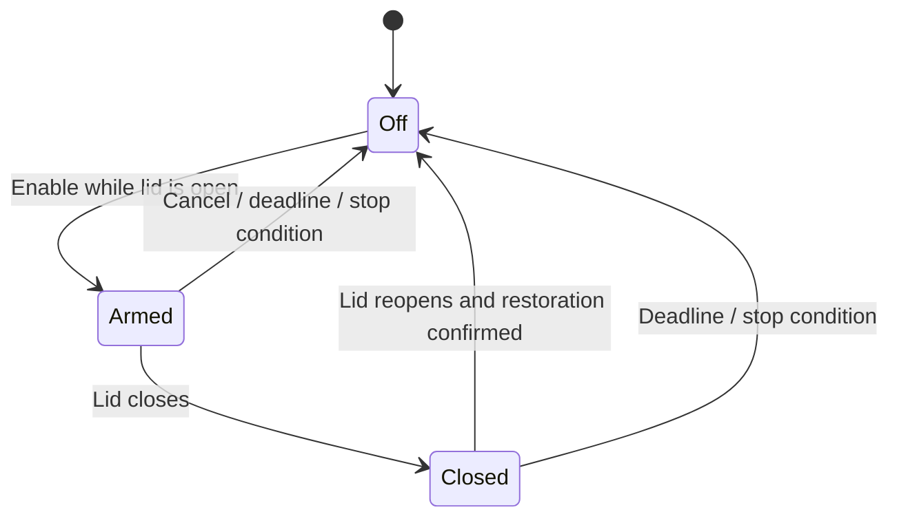

# Architecture

LidLid is organized into nine Swift Package targets with zero third-party dependencies:

- `LidOnceCore`: commands, snapshots, bilingual localization (`AppText`), StoreKit entitlement state machine (`StoreAccess`), one-shot closed-lid state machine (`OneShot`), and bounded open-lid / display keep-awake session logic (`OpenLidSession`).
- `LidLidServiceProtocol`: shared Mach service constants, code-signing requirements, and `@objc` XPC protocol (`LidLidSleepServiceProtocol`).
- `LidLidServiceCore`: pure leased sleep-setting state machine (`SleepLease`) and durable recovery journal model (`SleepJournal`).
- `LidLidServiceAuth`: Apple certificate provenance, CodeDirectory Team ID, signing identifier, and per-peer CDHash validation (`SleepServiceClientAuthentication`).
- `LidOnceSystem`: read-only IOKit lid/battery/display readers (`PowerDriver`), bounded public power assertions (`OpenLidAssertion`), XPC client with cancellable per-call deadlines (`CompatibilityClient`), and rotated local event log (`EventLog`).
- `LidOnce`: sandboxed menu-bar UI packaged as `Contents/MacOS/LidLid`.
- `LidOnceAgent`: sandbox-inheriting session worker packaged as `Contents/Helpers/LidLidAgent`.
- `LidLidCompatibility`: independently installed, Developer ID signed and notarized companion GUI that registers/unregisters the root daemon via `SMAppService.daemon`.
- `LidLidSleepService`: root LaunchDaemon bundled inside `LidLid Compatibility.app` that holds short renewable leases over system-wide `SleepDisabled` with a synced root-owned recovery journal.

The main app never makes developer backend requests. In App Store builds (`LidLidDistribution=app-store`), StoreKit communicates directly with Apple for the free 7-day trial and one-time lifetime unlock.

## Sandbox and privilege boundaries

- The main UI (`LidLid`) runs under `com.apple.security.app-sandbox` plus the team-prefixed App Group `63ALH54858.dev.kf.lidonce` (required by macOS for sandboxed XPC lookup to the companion Mach service without temporary sandbox exceptions).
- Its bundled worker (`LidLidAgent`) carries only `com.apple.security.app-sandbox` and `com.apple.security.inherit`, communicating over an anonymous stdin/stdout JSON pipe with 2-second UI heartbeats and 12-second heartbeat timeout.
- Closed-lid keep-awake never collects administrator passwords in LidLid and never invokes deprecated selector-12 hacks. Users independently install and approve `LidLid Compatibility.app` through macOS Service Management. See [docs/COMPATIBILITY-ENGINEERING.md](COMPATIBILITY-ENGINEERING.md) for the full XPC, CDHash pinning, and crash-recovery specification.
- `PrivacyInfo.xcprivacy` declares app-only preferences, monotonic elapsed-time checks, and file attributes inside the app container, with zero tracking or collected user data.

## Three independent keep-awake modes

1. **Closed-lid one-shot (`OneShot` + `LidLidSleepService`)**
   - Internally distinguishes `armed` from `closed` so an open-lid reading immediately after enabling never consumes the session. The first real `closed → open` transition ends the session and restores normal sleep.
   - Held under a 30-second continuous-clock lease renewed every 5 seconds. The root daemon independently monitors lid reopening, battery <= 10% on battery power, thermal pressure, console user changes, and duration deadlines, journaling original `SleepDisabled` state to disk (`fsync` + `F_FULLFSYNC` + atomic rename) before mutation.
   - On observed lid close, the worker asks macOS to sleep the display via `/usr/bin/pmset displaysleepnow` without altering screen-lock preferences.



2. **Open-lid keep-awake (`OpenLidSession` — always free, no component needed)**
   - Holds a bounded public `kIOPMAssertionTypePreventUserIdleSystemSleep` assertion with a 30-second automatic `TimeoutActionRelease`, renewed every 5 seconds.
   - Allows the display to sleep normally, pauses automatically on lid close or manual sleep, resumes on reopen/wake, and stops on quit or low battery / high thermal pressure.

3. **Keep display awake (`OpenLidSession` with `.display` scope — always free, no component needed)**
   - Holds a bounded public `kIOPMAssertionTypePreventUserIdleDisplaySleep` assertion for 30 minutes, 1 hour, or until manually turned off.
   - Ends automatically when the lid closes, the Mac sleeps, the timer expires, or safety limits trigger.

## Stop conditions and recovery

- Manual off, right-click menu toggle, or normal quit.
- First observed `closed → open` transition (closed-lid mode) or lid close (display keep-awake).
- Optional time limit (30m–8h for closed-lid; 30m/1h/until off for display awake).
- Battery power at or below 10%, `serious`/`critical` thermal pressure, missing battery/lid readings, or external display connection (closed-lid).
- Parent pipe EOF, >12s UI heartbeat gap, XPC disconnect, or termination signals.
- When idle (no mode active and no restoration pending), the worker backs off polling from 4 Hz to 3 s while continuing to receive immediate hardware lid callbacks via `IONotificationPort`, and skips JSON encoding unless `Snapshot` changes.

## Local data

Preferences (`appLanguage`, `maximumMinutes`, `displayAwakeMinutes`, and App Store high-water clock date) live in container-scoped `UserDefaults`. Local event logs and the single-agent lock live in `~/Library/Containers/dev.kf.lidonce/Data/Library/Application Support/LidOnce/`. `events.log` rotates at 512 KB and retains at most 5 archived files.

## Building and checking

```sh
swift test
zsh scripts/test-store-model.sh
zsh scripts/build.sh
python3 scripts/verify-sandbox.py dist/LidLid.app
zsh scripts/build-compatibility.sh
python3 scripts/verify-compatibility.py "dist/LidLid Compatibility.app"
node scripts/prepare-app-store.mjs
node website/build.mjs
```
