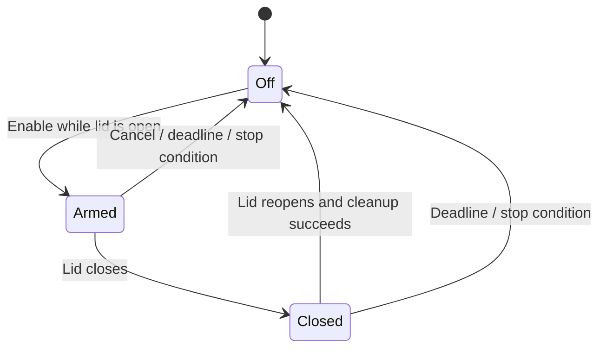

# Architecture

LidLid has four Swift Package targets:

- `LidOnceCore`: commands, snapshots, localization, and the one-shot state machine.
- `LidOnceSystem`: shared IOKit power requests and local event records.
- `LidOnce`: the menu-bar UI, packaged as `Contents/MacOS/LidLid`.
- `LidOnceAgent`: the session owner, packaged as `Contents/Helpers/LidLidAgent`.

There are no third-party package dependencies. The app does not make network requests.

## Sandbox boundary

The UI is signed with only `com.apple.security.app-sandbox`. Its bundled, separately signed agent has only `com.apple.security.app-sandbox` and `com.apple.security.inherit`; it inherits the UI's sandbox when launched with `Process`. It is not a privileged service or a separately downloaded companion. No root permission, temporary IOKit exception, network entitlement, or broad file access is requested.

The UI and agent share the app's normal sandbox container. Agent stdout is an anonymous JSON pipe, not a network or Mach service. The UI performs recovery through its own IOKit connection if the agent dies. A helper with inheritance entitlements must be launched by the sandboxed UI executable, not directly from a shell.

`scripts/verify-sandbox.py` verifies both signatures and runs the read-only `--sandbox-check` path through the signed parent and embedded agent. It verifies the inherited container and power-domain connection without changing power settings. It runs in CI, including on Macs without lid sensors.

The `PrivacyInfo.xcprivacy` resource declares app-only preferences, monotonic elapsed-time checks, and attributes of files in the app container. It declares no tracking or collected data. Local builds use ad-hoc signing by default; `LIDLID_CODE_SIGN_IDENTITY` can select an available signing identity. A sandbox build is not an App Store approval or a notarized release.

## One visible switch, two internal stages

The visible interface has only off and on. Internally, the session distinguishes `armed` from `closed` so an open-lid reading immediately after activation cannot consume the session. A real closed → open transition ends it. The UI maps both stages to the same awake owl.



The optional deadline begins at activation. Relaunching the app never automatically reactivates a hold.

## Power requests

`PowerDriver` opens `IOPMrootDomain` as the current user. It invokes `IOConnectCallScalarMethod` using the SDK constant `kPMSetClamshellSleepState` to set or clear the clamshell-sleep suppression bit. It holds one `kIOPMAssertionTypePreventUserIdleSystemSleep` assertion. The deprecated `PreventSystemSleep` assertion is not used.

The selector is declared in the macOS SDK header `IOPMLibDefs.h`, also included by `IOPMLib.h`. This does not establish App Review acceptance or guarantee behavior on every Mac/OS combination. It remains separate from a normal idle-sleep assertion. Activation does not require AC power or an external display.

The agent listens for general-interest clamshell notifications and also reads the lid state every 250ms. Screen/wake and power-source changes trigger reapplication; it also reapplies once per second while active. On an observed lid close, it requests display sleep with `/usr/bin/pmset displaysleepnow`.

`AppleClamshellCausesSleep` is a cached aggregate property. Apple's implementation does not republish it every time selector 12 changes the mask. It is diagnostic data, not independent read-back proof of the app's hold or cleanup. Software checks use accepted IOKit return values and observed assertion creation/release; hardware validation remains separate.

## Stop conditions

- Manual off or normal quit.
- The first observed closed → open transition.
- An optional deadline.
- Battery power at or below 10%.
- `serious` or `critical` thermal pressure reported by macOS.
- Missing battery/lid readings, or an external display appearing.
- System sleep, parent pipe EOF, missing UI heartbeat, or termination signals handled by the agent.

The app does not deliberately test overheating or battery depletion.

## Recovery limits

The UI keeps an anonymous stdin pipe open to the agent and sends heartbeats every two seconds. EOF or a heartbeat gap greater than 12 seconds makes the agent release its own hold. If the agent exits, a surviving UI can clear the kernel bit. Cleanup errors leave a process retrying and show a warning.

**At least one process must remain alive for these paths to work.** Simultaneously force-killing both processes, a system fault, a hung agent, or a changed kernel interface can leave behavior uncertain. Keep the lid open and restart the Mac if normal lid behavior cannot be restored. No root watchdog or persistent launch daemon is installed.

The kernel bit is global, not a process-scoped lease. The app uses a per-user lock and blocks activation while Clamshell runs, but cannot arbitrate every possible third-party controller or multi-user session. Use one lid controller at a time.

## Local data

The app stores a duration preference and local event records. Since 1.3, records and the single-agent lock live in `~/Library/Containers/dev.kf.lidonce/Data/Library/Application Support/LidOnce/`. The previous non-sandbox directory is left untouched. Preferences use the app's container-scoped `UserDefaults`; a new installation defaults to the system language and no time limit.  `events.log` records only this app's activation, lid events, and cleanup. Logs over 512KB are retained as timestamped files. They are not uploaded automatically or included in this repository.

## Building and checking

```sh
swift test
zsh scripts/build.sh
python3 scripts/verify-sandbox.py dist/LidLid.app
```

With the UI quit and the lid open, the optional hardware integration check exercises real reversible requests:

```sh
python3 scripts/integration.py dist/LidLid.app/Contents/MacOS/LidLid
```

This checks cancellation, duplicate-agent exclusion, pipe EOF, heartbeat timeout, and agent termination. It records accepted restoration calls and assertion release; it does not synthesize physical lid events.

## References

- [Apple IOPMLibDefs.h](https://github.com/apple-oss-distributions/xnu/blob/main/iokit/IOKit/pwr_mgt/IOPMLibDefs.h)
- [Apple RootDomainUserClient.cpp](https://github.com/apple-oss-distributions/xnu/blob/main/iokit/Kernel/RootDomainUserClient.cpp)
- [Apple IOPMrootDomain.cpp](https://github.com/apple-oss-distributions/xnu/blob/main/iokit/Kernel/IOPMrootDomain.cpp)
- [Apple IOPMLib.h](https://github.com/apple-oss-distributions/IOKitUser/blob/main/pwr_mgt.subproj/IOPMLib.h)
