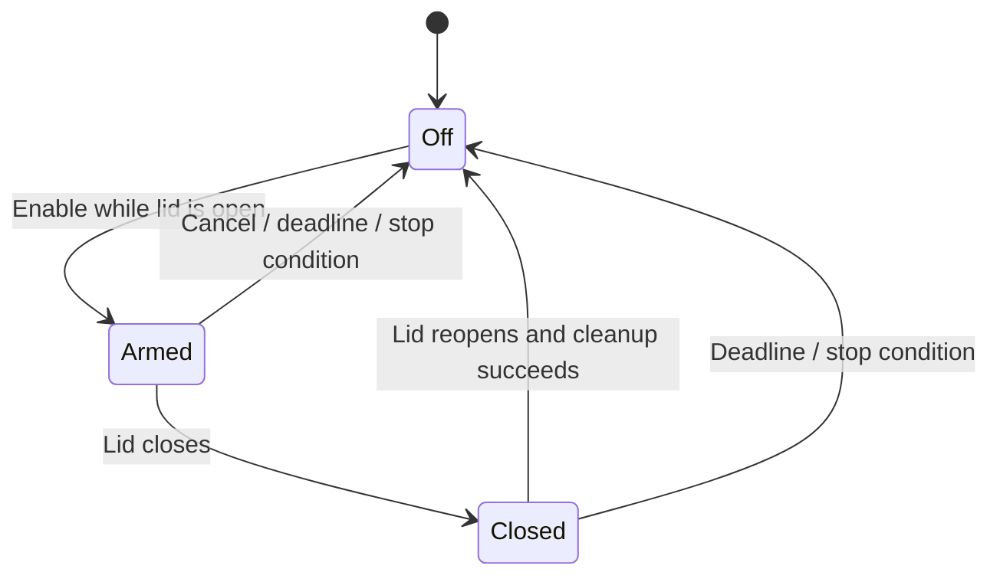

# Architecture

LidLid is a Swift Package with two targets:

- `LidOnceCore`: commands, snapshots, and the one-shot state machine.
- `LidOnce`: the internal Swift executable target. It is packaged as `LidLid.app/Contents/MacOS/LidLid`, providing the AppKit/SwiftUI menu-bar UI and the unprivileged session process started with `--agent`.

There are no third-party package dependencies. The app does not make network requests.

## One visible switch, two internal stages

The visible interface has only off and on. Internally, the session distinguishes `armed` from `closed` so an open-lid reading immediately after activation cannot consume the session. A real closed → open transition ends it. The UI maps both stages to the same awake owl.

The optional deadline begins at activation. Relaunching the app never automatically reactivates a hold.

## Power requests

`PowerDriver` opens `IOPMrootDomain` as the current user. It invokes `IOConnectCallScalarMethod` selector 12, published in Apple's `IOPMLibDefs.h` as `kPMSetClamshellSleepState`, to set or clear the clamshell-sleep suppression bit. It also holds `PreventUserIdleSystemSleep` and `PreventSystemSleep` assertions.

This is an undocumented user-client interface, not a supported public promise from Apple. An accepted call does not establish that every Mac/OS combination will behave as intended.

The agent listens for general-interest clamshell notifications and also reads the lid state every 250ms. Screen/wake and power-source changes trigger reapplication; it also reapplies once per second while active. On an observed lid close, it requests display sleep with `/usr/bin/pmset displaysleepnow`.

`AppleClamshellCausesSleep` is a cached aggregate property. Apple's implementation does not republish it every time selector 12 changes the mask. It is diagnostic data, not independent read-back proof of the app's hold or cleanup. Software checks use accepted IOKit return values and observed assertion creation/release; hardware validation remains separate.

## Stop conditions

- Manual off or normal quit.
- The first observed closed → open transition.
- An optional deadline.
- Battery power at or below 10%.
- `serious` or `critical` thermal pressure reported by macOS.
- Missing battery/lid readings, or an external display appearing.
- System sleep, parent pipe EOF, missing UI heartbeat, or termination signals handled by the agent.

The app does not deliberately test overheating or battery depletion.

## Recovery limits

The UI keeps an anonymous stdin pipe open to the agent and sends heartbeats every two seconds. EOF or a heartbeat gap greater than 12 seconds makes the agent release its own hold. If the agent exits, a surviving UI can clear the kernel bit. Cleanup errors leave a process retrying and show a warning.

**At least one process must remain alive for these paths to work.** Simultaneously force-killing both processes, a system fault, a hung agent, or a changed kernel interface can leave behavior uncertain. Keep the lid open and restart the Mac if normal lid behavior cannot be restored. No root watchdog or persistent launch daemon is installed.

The kernel bit is global, not a process-scoped lease. The app uses a per-user lock and blocks activation while Clamshell runs, but cannot arbitrate every possible third-party controller or multi-user session. Use one lid controller at a time.

## Local data

The app stores a duration preference and local event records. The legacy support directory is `~/Library/Application Support/LidOnce/`; `events.log` records only this app's activation, lid events, and cleanup. Logs over 512KB are retained as timestamped files. They are not uploaded automatically or included in this repository.

## References

- [Apple IOPMLibDefs.h](https://github.com/apple-oss-distributions/xnu/blob/main/iokit/IOKit/pwr_mgt/IOPMLibDefs.h)
- [Apple RootDomainUserClient.cpp](https://github.com/apple-oss-distributions/xnu/blob/main/iokit/Kernel/RootDomainUserClient.cpp)
- [Apple IOPMrootDomain.cpp](https://github.com/apple-oss-distributions/xnu/blob/main/iokit/Kernel/IOPMrootDomain.cpp)
- [Apple IOPMLib.h](https://github.com/apple-oss-distributions/IOKitUser/blob/main/pwr_mgt.subproj/IOPMLib.h)
