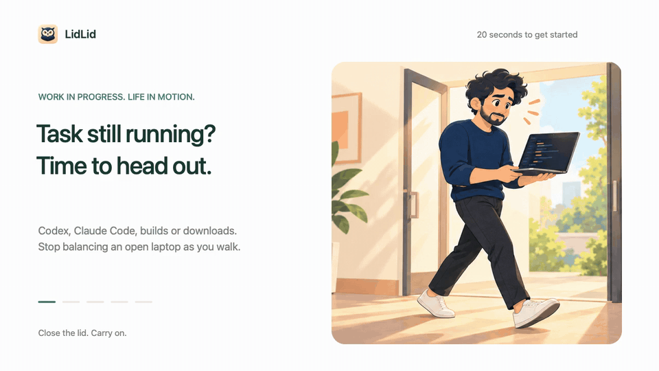
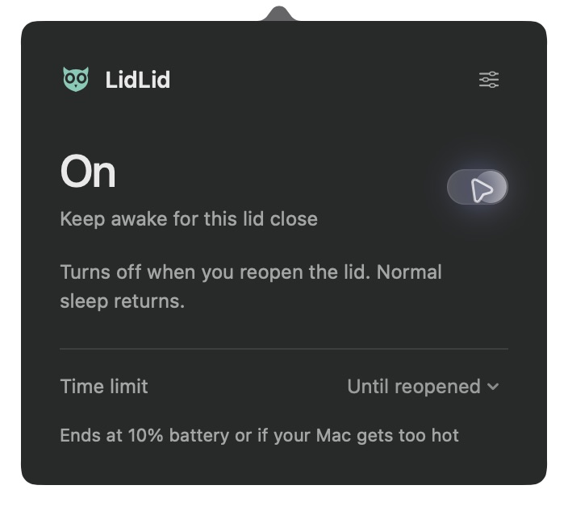
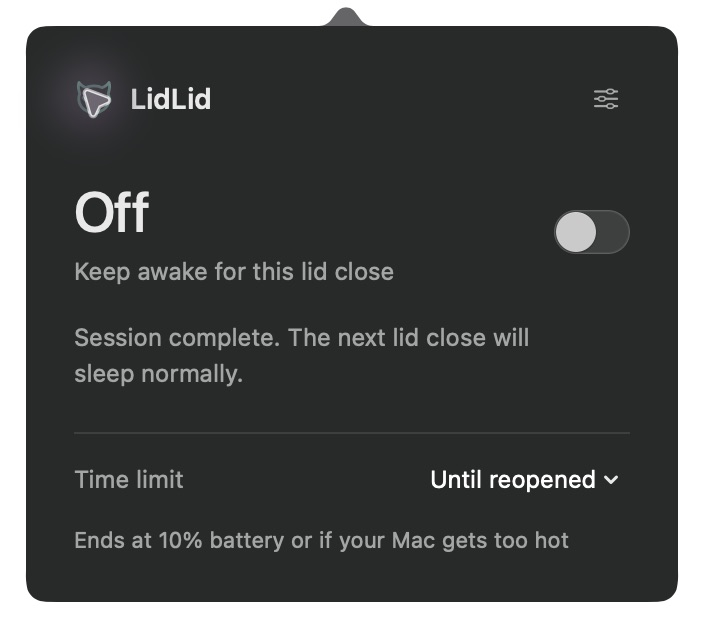
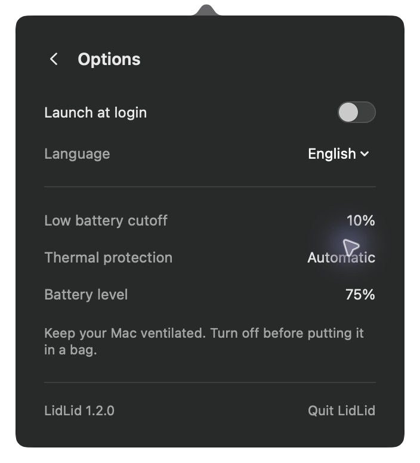

# Keep Codex and Claude Code running with your MacBook lid closed

Your task is still running, but you need to go. With LidLid, turn on one switch, close your MacBook and take it with you. Reopening the lid ends the session automatically.

[简体中文](USAGE.zh-CN.md) · [Download DMG](https://github.com/kf953741/lidlid/releases/download/v1.2.0/LidLid-1.2.0-macOS-arm64.dmg) · [Watch the 20-second demo (MP4)](assets/en/usage-demo.mp4)

*Actual app interface with illustrated on-the-go scenes.*

## 1. Download and drag to Applications

LidLid is for **Apple Silicon MacBook Air and MacBook Pro, macOS 14 or later**. No external monitor is needed. Intel Macs are not currently supported.

Open the [DMG installer](https://github.com/kf953741/lidlid/releases/download/v1.2.0/LidLid-1.2.0-macOS-arm64.dmg), drag LidLid into **Applications**, then launch it. Look for the owl in your menu bar.

This build is not notarized. If macOS blocks the first launch, review and allow it in System Settings → Privacy & Security.

## 2. Switch on while your task is running

Start your local Codex or Claude Code task, build or download as usual. When you need to leave, click the owl and turn on **Keep awake for this lid close**. Wait until LidLid shows **On**, then close the lid.

  
  

The default **Time limit** is **Until reopened**. Before switching on, you can choose 30 minutes, 1, 2, 4 or 8 hours instead. The timer begins when you switch on; reopening ends the session sooner.

## 3. Close and carry. Reopen to finish

Close your MacBook and take it with you. When you open the lid again, LidLid returns to **Off** automatically. Turn it on again next time you need it. You can also switch it off manually at any time.

Keep your Mac ventilated while carrying it; end the session before putting it in a bag or sleeve. Online tasks still need a connection. Switching Wi-Fi networks or VPNs can interrupt them. LidLid ends the session at 10% on battery power or on serious thermal pressure.

## Choose English or Chinese

Open **Options → Language** and select **English**, **简体中文** or **System default**. The interface changes immediately.

See the English options page

## Two things to know for Codex and Claude Code

- **This is for local work.** Jobs already running on a remote server or in the cloud do not need LidLid to keep that remote machine working.
- **You still handle approvals.** LidLid does not approve agent permission requests or detect task completion. Reopening, manual off, the time limit or a protection condition ends the session.

Need help? [Report your setup](https://github.com/kf953741/lidlid/issues/new?template=compatibility.yml) or read the [README FAQ](../README.md#frequently-asked-questions).
