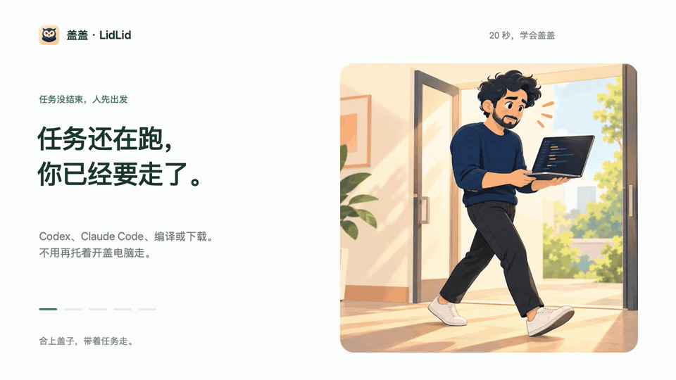
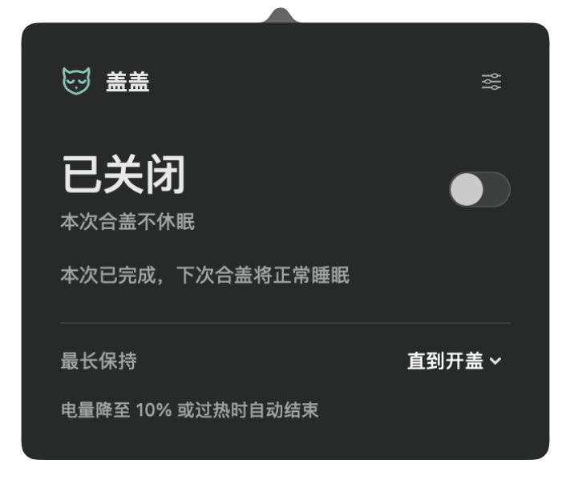
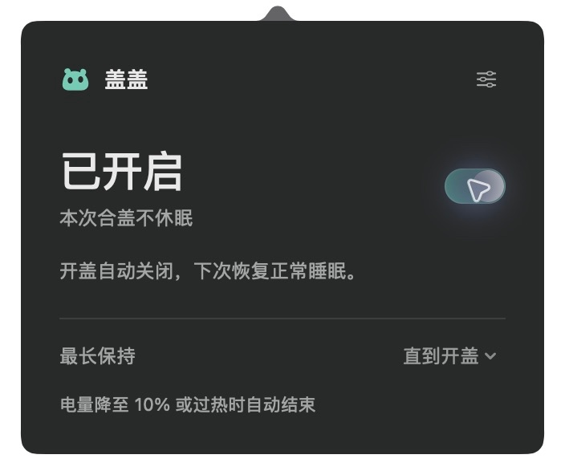
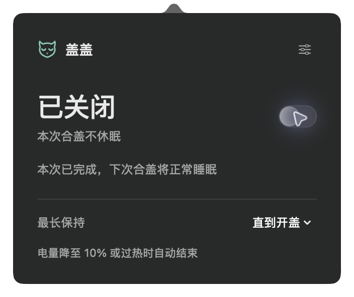
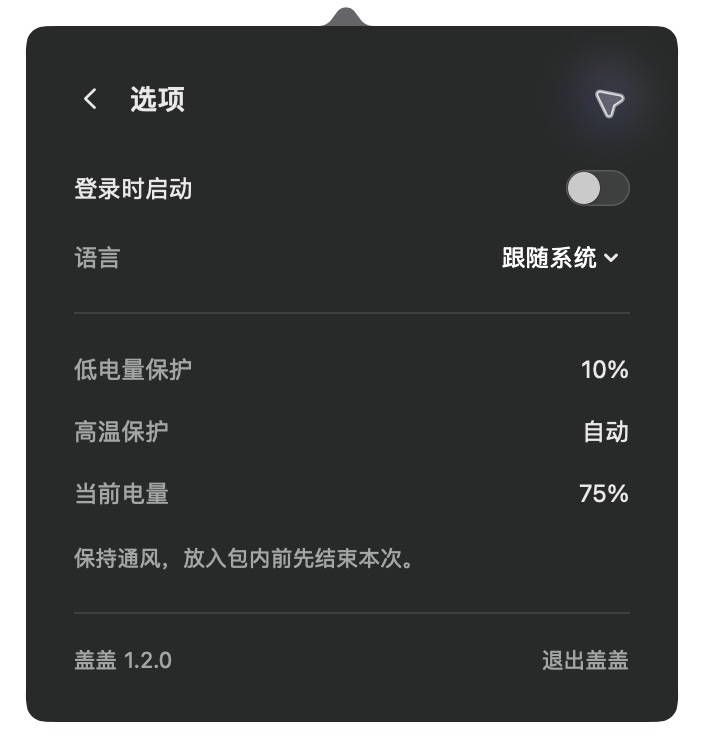

# MacBook 合盖不休眠：让 Codex、Claude Code 在你出发时继续工作

任务还没跑完，你却已经要出门或换个地方。用盖盖，打开一个开关，就可以合上电脑、带着它走。再次开盖，本次自动结束。

[English](USAGE.md) · [直接下载 DMG](https://github.com/kf953741/lidlid/releases/download/v1.2.0/LidLid-1.2.0-macOS-arm64.dmg) · [下载 20 秒视频（MP4）](https://github.com/kf953741/lidlid/raw/refs/heads/main/docs/assets/zh-CN/usage-demo.mp4)

*真实应用界面，搭配移动办公场景插画。*

## 1. 下载，拖进「应用程序」

盖盖适用于 **M 系列 MacBook Air／MacBook Pro、macOS 14 或更新版本**。不需要外接显示器，目前不支持 Intel Mac。

打开 [DMG 安装包](https://github.com/kf953741/lidlid/releases/download/v1.2.0/LidLid-1.2.0-macOS-arm64.dmg)，把「盖盖」拖入「应用程序」，再打开它。菜单栏会出现一只猫头鹰。

安装包尚未经过 Apple 公证。如果首次打开被拦截，请在「系统设置 → 隐私与安全性」检查并确认打开。

## 2. 任务在跑时，打开盖盖开关

先照常在 Mac 本机启动 Codex、Claude Code、编译或下载任务。准备走时，点击菜单栏的猫头鹰，打开「**本次合盖不休眠**」。看到「**已开启**」，就可以合盖。

  
  

「最长保持」默认是「**直到开盖**」。也可以在开启前改成 30 分钟、1／2／4／8 小时；时间从开启开关时计算，提前开盖仍会结束。

## 3. 合盖带走，开盖自动结束

合上电脑，带着它去下一个地方。重新打开盖子时，盖盖会自动回到「**已关闭**」；下次需要时，再开启一次。也可以随时手动关闭开关。

移动时保持通风，放入包或保护套前先结束本次。联网任务仍需网络连接；切换 Wi-Fi、VPN 或离开网络覆盖范围，仍可能中断任务。电池供电降至 10% 或出现严重高温时，盖盖会结束本次。

## 切换中英文

点击右上角「选项」，在「语言」中选择「简体中文」「English」或「跟随系统」，立即生效。

查看中文选项页

## 使用 Codex／Claude Code 时，记住两件事

- **面向本机任务。** 已经在云端或远程服务器执行的任务，不需要靠盖盖维持远端机器运行。
- **任务需要确认时，仍要由你处理。** 盖盖不替你批准 AI 工具的权限请求，也不自动判断任务完成；本次会话主要在开盖、手动关闭、达到时限或触发保护条件时结束。

遇到问题可以[反馈问题或建议](https://github.com/kf953741/lidlid/issues)，也可以返回[盖盖首页](../README.zh-CN.md)。
